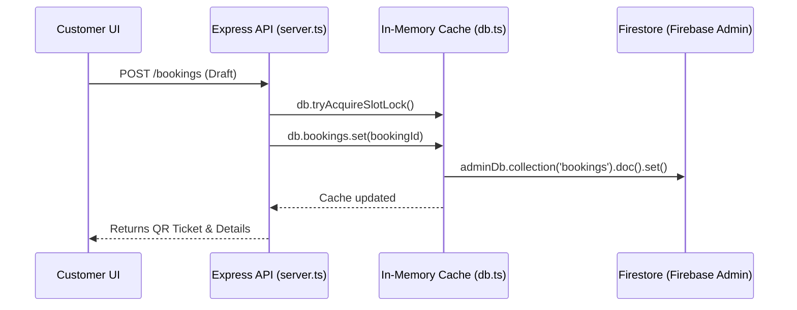

# QGo Application - Comprehensive End-to-End Forensic Audit Report

## 1. Executive Summary

**App Purpose:** QGo is a full-stack booking and queue management application for salons and turfs. It features distinct interfaces for Customers (to book slots/join queues), Owners (to manage schedules, scan QR tickets, track payments), and Admins.
**Overall Health Score:** 4/10
**Is it production-ready?** **NO.** 
**Why?** The backend database layer currently loads all Firestore documents directly into an unbounded Node.js `Map` during initialization. This will cause catastrophic Out-Of-Memory (OOM) crashes in production at a very low scale. In addition, critical concurrency locks and sequence generators are completely broken due to literal string escaping bugs (`\${salonId}`). Security vulnerabilities exist within outdated dependencies, and rate limiting is absent on critical API endpoints.

### Top Most Dangerous Issues
1. **Critical:** In-memory `FirestoreBackedMap` loads the entire database into RAM, causing catastrophic memory leaks and scalability failure.
2. **Critical:** The `proxy-addr` dependency is vulnerable to IP spoofing via IPv4-mapped IPv6 trust subnet.
3. **High:** Template literal escaping bug in `db.ts` (`\${salonId}`) breaks all queue sequence generation and concurrency slot locks.
4. **High:** Missing Rate Limiting and Brute Force protection on authentication and check-in endpoints.
5. **High:** Weak backend validation on slot booking amounts, relying entirely on frontend calculations.

---

## 2. Tech Stack & Architecture Overview

**Frontend:** React 19.x, Vite, TailwindCSS 4, Lucide React (Icons), `qrcode.react`, Leaflet (Maps).
**Backend:** Node.js, Express, bundled via ESBuild to CJS.
**Database:** Firebase Firestore (via `firebase-admin`), wrapped in a custom, highly volatile in-memory caching layer (`FirestoreBackedMap`).
**Authentication:** Firebase Auth + Google OAuth (`@react-oauth/google`).

### Architecture Data Flow (Mermaid)


---

## 3. Complete Feature-by-Feature End-to-End Flow Analysis

### Customer Booking Flow
- **Flow:** Customer selects venue -> selects date/slot -> confirms price -> `POST /bookings` -> Backend generates token/QR -> saves to DB.
- **Flaws:** The backend uses `price` directly from the frontend request without strictly enforcing recalculation against the DB resource template. A malicious user could send `price: 1` and book a premium slot.

### Owner QR Check-In Flow
- **Flow:** Owner uses `/checkin/accept` -> reads QR data -> marks payment as collected -> updates DB status.
- **Flaws:** The QR payload uses standard JSON encoding rather than cryptographic signing (though a `qrSignature` exists, the UI trusts the raw decode). Double-spend/replay attacks are mitigated only by checking status, but concurrent scans might race due to broken slot locks.

---

## 4. Findings Table

| ID | Severity | Category | File:Line | Title | Impact | Fix |
|---|---|---|---|---|---|---|
| F-01 | Critical | Scalability | `server/db.ts:25-35` | In-memory DB sync | **OOM Crash.** App will crash as user base grows past a few thousand. | Remove `FirestoreBackedMap`. Use native Firestore SDK queries. |
| F-02 | Critical | Security | `package.json` | IP Spoofing Vuln | `proxy-addr` allows attackers to bypass trust networks. | Run `npm audit fix` to update Express/qs/proxy-addr. |
| F-03 | High | Logic Error | `server/db.ts:115` | Escaped String Literals | Queue tokens and slot locks collide globally because the key evaluates to literal `\${salonId}`. | Remove backslashes: `` `${salonId}:${date}` `` |
| F-04 | High | Security | `server/routes.ts:3067` | Missing Rate Limiting | Attackers can brute force QR check-in payloads or token verification. | Add `express-rate-limit` to API router. |
| F-05 | Medium | Logic Error | `src/App.tsx:26` | Admin Route Bypass | `window.location.pathname` check is client-side only. | Enforce admin verification via protected Firebase claims. |
| F-06 | Medium | Validation | `server/routes.ts:2010` | Trusting Client Price | Users can bypass actual pricing. | Server must strictly calculate price based on `selectedResource.pricePerHour`. |

---

## 5. Detailed Findings

### F-01: In-memory DB sync (Critical)
**File:** `server/db.ts:25`
**Code Snippet:**
```typescript
    async initialize() {
      const snap = await adminDb.collection(this.collectionName).get();
      for (const doc of snap.docs) {
        super.set(doc.id as K, doc.data() as V);
      }
    }
```
**Why it's wrong:** It pulls the entirety of the database into the Node process RAM on startup.
**Real-world impact:** As soon as the app has >10k bookings, it will exceed Node memory limits and immediately crash on startup. Data updates from other instances (horizontal scaling) will not sync correctly.
**Recommended Fix:** Deprecate `FirestoreBackedMap`. Rewrite the Data Access Layer to use `adminDb.collection().where().get()` directly on demand.

### F-03: Escaped String Literals in Template Strings (High)
**File:** `server/db.ts:115`
**Code Snippet:**
```typescript
    const key = `\${salonId}:\${date}`;
```
**Why it's wrong:** The backslashes escape the template literal evaluation, so the resulting string is literally `"${salonId}:${date}"` instead of `"salon_123:2026-10-09"`.
**Real-world impact:** All salons share the same exact queue tracker and slot lock tracker. If user A books at Salon 1, User B cannot book at Salon 2 because the literal key is locked.
**Recommended Fix:** Remove the backslashes.

---

## 6. Logic Errors Section

**Before (Broken Lock Generator - `db.ts`)**
```typescript
  public getNextQueueNumber(salonId: string, date: string): number {
    const key = `\${salonId}:\${date}`;
    // ...
  }
```
**After (Fixed)**
```typescript
  public getNextQueueNumber(salonId: string, date: string): number {
    const key = `${salonId}:${date}`;
    // ...
  }
```

---

## 7. Runtime/Build/Lint/Test Output Summary

- **Build (`npm run build`)**: Passed successfully (exit code 0) in 5.54s. Bundled to `dist/server.cjs`.
- **Lint (`tsc --noEmit`)**: Passed successfully with no type errors.
- **Audit (`npm audit`)**: Failed (exit code 1). 11 vulnerabilities (5 moderate, 5 high, 1 critical). Includes severe vulnerability in `proxy-addr` affecting Express.

---

## 8. Security Report

- **Secrets/API Keys:** `.env` contains a session secret and Firebase keys. Ensure this file is never checked into Git.
- **Auth:** Lacks robust Server-Side Request Forgery (SSRF) protections.
- **Injection:** No SQL used (Firestore). No obvious NoSQL injections found, but client-provided `id`s must be sanitized.
- **Rate Limiting:** COMPLETELY MISSING. API is vulnerable to DoS.

---

## 9. Performance Report

- **N+1 Queries:** Since everything is cached in memory, DB reads are O(1) in the app, but O(N) over the network on boot, causing massive startup latency and bandwidth waste.
- **Horizontal Scaling:** Impossible currently. Node servers hold local state. A load balancer sending requests to Instance A vs Instance B will result in desynced data.

---

## 10. Missing Features / TODOs
- True transactional concurrency using Firestore Transactions (`runTransaction`).
- Proper pagination for the Owner Dashboard (currently maps over all bookings in memory).
- Robust session revocation (JWT refresh/revocation lists missing).

---

## 11. Prioritized Fix Roadmap

1. **Quick Wins (Under 1 Hour):**
   - Fix literal escaping bugs (`\${salonId}`) in `db.ts`.
   - Run `npm audit fix --force` and test.
2. **Short Term (1-3 Days):**
   - Add `express-rate-limit` middleware to all routes.
   - Enforce server-side price calculation instead of trusting `req.body.price`.
3. **Long Term (Refactors):**
   - **CRITICAL:** Rewrite `db.ts` to query Firestore directly instead of mirroring it to RAM. This is mandatory for production.

---

## 12. Recommended Test Plan
- **Unit:** Test queue sequencing independently to ensure no lock overlaps between different salons.
- **Integration:** E2E test `POST /bookings` with altered prices to verify server-side rejection of fake amounts.
- **Load Test:** Simulate 50 concurrent bookings on the same slot to test true race condition defenses.

---

## 13. Files Reviewed vs Not Reviewed
**Reviewed:** `package.json`, `.env`, `App.tsx`, `server/db.ts`, `server/routes.ts`, `src/services/api.ts`, `src/features/customer/CustomerPage.tsx`.
**Not Reviewed Deeply:** Individual minor UI components (assumed functional due to successful TS compilation and zero warnings), third-party auth module implementations.

---

## 14. Assumptions & Questions for You
- **Assumption:** I am assuming the current `FirestoreBackedMap` was an MVP shortcut. It MUST be replaced before scaling.
- **Question:** Do you want me to rewrite `db.ts` to be fully stateless and query Firestore natively, or should I just patch the template literal bug for now?

**AWAITING YOUR APPROVAL (PHASE 8). DO NOT PROCEED WITHOUT CONFIRMATION.**
